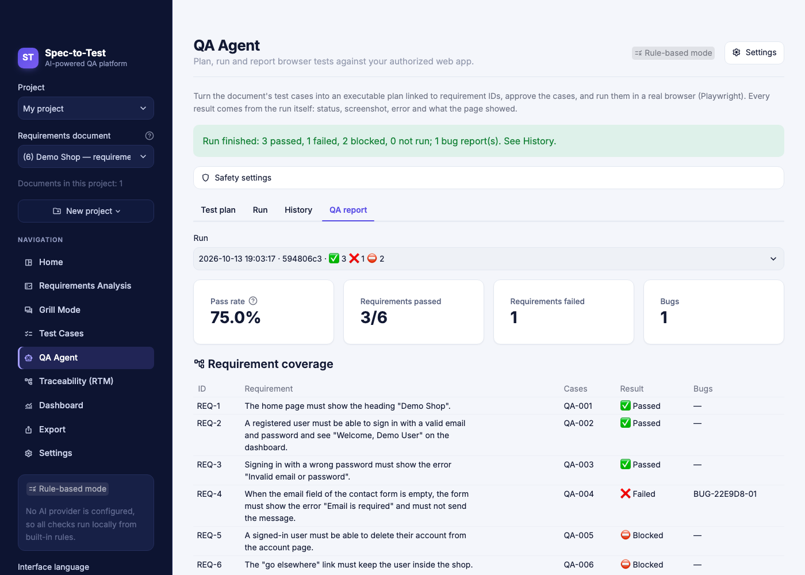
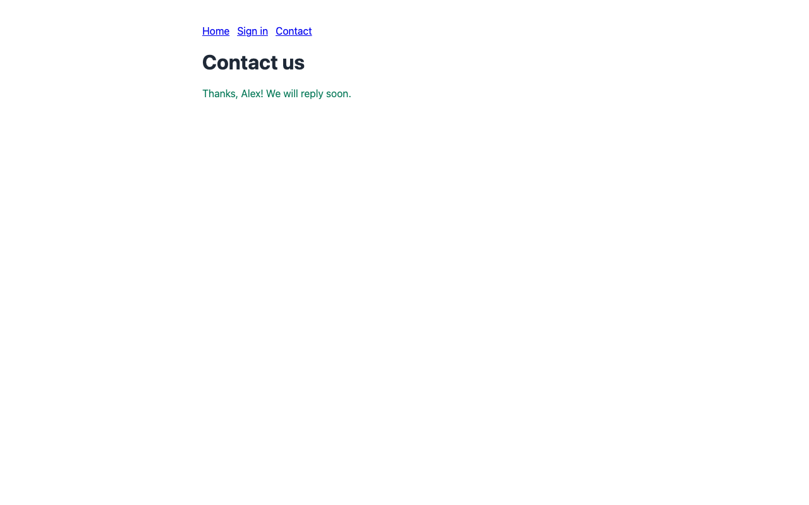

# QA Agent

The **QA Agent** page turns the open document's requirements and test cases
into an executable test plan, runs the approved cases in a real browser
(Python Playwright, headless Chromium) against a web app you are authorized to
test, and records what happened: status, screenshot, error, the text the page
showed, and a bug report for every failure. Runs are saved, can be reopened
and retested, and export as a QA report with requirement coverage.

It works without an AI key. AI is used only if you ask it to propose steps for
a case, and what it proposes is data that you review and approve.

The page has two modes. **Manual plan** (this document) starts from an
analyzed document. **Autonomous QA** starts from a URL: it explores the site
read-only, drafts evidence-based requirements and tests, and runs them after
your approval — see [AUTONOMOUS_QA.md](AUTONOMOUS_QA.md).

## Try it in two minutes (Demo Shop)

```bash
pip install -r requirements-qa.txt
python -m playwright install chromium

# Terminal 1: the demo web app (standard library only), http://127.0.0.1:8765
python examples/qa_demo/server.py

# Terminal 2: the app, allowed to test the demo app
AUTOMATION_ALLOWED_HOSTS=127.0.0.1:8765 \
AUTOMATION_ALLOW_PRIVATE_NETWORK=true \
AUTOMATION_SECRET_DEMO_PASSWORD=demo-pass-123 \
streamlit run app.py
```

1. **Home**: upload `examples/qa_demo/requirements.md` and analyze it.
2. **QA Agent → Test plan**: enter `http://127.0.0.1:8765/`. Under
   *Import / export the plan*, import `examples/qa_demo/plan.json`, then
   **Approve to run** each case (imports never carry approvals).
3. **Run**: tick *I am authorized to test 127.0.0.1:8765…* and run.
4. **History** shows each case with its screenshot; **QA report** has the
   coverage table and the downloads.

What you should see (this is what the real run produced on the development
machine; see "Verification" below):

| Case | Requirement | Result | Why |
|---|---|---|---|
| QA-001 | REQ-1 | Passed | Heading "Demo Shop" is visible |
| QA-002 | REQ-2 | Passed | Signs in with the password from `AUTOMATION_SECRET_DEMO_PASSWORD` |
| QA-003 | REQ-3 | Passed | "Invalid email or password" is shown |
| QA-004 | REQ-4 | **Failed** | Deliberate bug: an empty email is accepted ("Thanks, Alex!") — a bug report is created |
| QA-005 | REQ-5 | Blocked | The step would click "Delete account"; destructive actions are off |
| QA-006 | REQ-6 | Blocked | `/go-elsewhere` redirects to another local port; the browser is stopped |



Evidence captured for the failing case QA-004 (the app thanks the user even
though the email is empty):



The same run from the command line (useful in CI):

```bash
cd src
AUTOMATION_ALLOWED_HOSTS=127.0.0.1:8765 AUTOMATION_ALLOW_PRIVATE_NETWORK=true \
AUTOMATION_SECRET_DEMO_PASSWORD=demo-pass-123 \
python -m spec_to_test.qa_agent --plan ../examples/qa_demo/plan.json \
  --requirements ../examples/qa_demo/requirements.md \
  --approve-all --authorized --out ../qa-output
```

It prints one line per case, writes `report.md` and `qa-report.zip` into the
run folder, and exits 0 only when nothing failed or was blocked.

## Workflow

| Step | Where | What happens |
|---|---|---|
| 1. Target | Test plan tab | Enter the web app URL. It is checked at once against the operator's allowlist and the network safety rules. |
| 2. Plan | Test plan tab | **Add cases from test cases** creates one plan case per test case (optionally only *Approved* ones), linked to its requirement and test case IDs. You can also add cases by hand or import a plan JSON. |
| 3. Edit | Each case | Title, requirement, steps, expected result. Steps are written in the step language below. |
| 4. Approve | Each case | A case needs steps and at least one check. Editing it afterwards revokes the approval. |
| 5. Run | Run tab | Confirm you are authorized to test the host, optionally allow destructive actions, and run. Progress is shown per case. |
| 6. Review | History tab | Results, screenshots, errors, console errors, blocked requests, bug reports (title and severity editable). **Retest failed and blocked cases** runs them again (using the current version of each case) as a new run linked to the old one. |
| 7. Report | QA report tab | Coverage by requirement and downloads: Markdown report, ZIP (report, run JSON, CSVs, screenshots), run JSON, results CSV, bug reports CSV. |

### From test cases to steps

Concrete test steps are converted deterministically, for example:

| Written step | Becomes |
|---|---|
| `Open /login` | `goto /login` |
| `Enter "demo@example.com" in the "Email" field` | `fill label=Email \| demo@example.com` |
| `Leave the Email field empty` | `fill label=Email \| {{empty}}` |
| `Click the "Sign in" button` | `click role=button[name=Sign in]` |
| `Select "Ukraine" from the "Country" list` | `select label=Country \| Ukraine` |
| Expected: `redirected to /dashboard and shows "Welcome"` | `expect_url /dashboard`, `expect_text Welcome` |

If **any** step of a test case cannot be read (for example the generic
"Perform the action described in the requirement." that rule-based generation
writes), the plan case gets **no steps** and lists the unreadable text. A
partly converted case would test something other than what was written, so
nothing is guessed. Write the steps yourself or ask AI to propose them.

## Step language

One step per line: `action target | value`. Lines starting with `#` are comments.

| Action | Form | Notes |
|---|---|---|
| `goto` | `goto /path` or `goto https://host/path` | Must stay on an allowed host. |
| `fill` | `fill <target> \| text` | `{{secret:NAME}}` types `AUTOMATION_SECRET_NAME`; `{{empty}}` clears the field. |
| `click` | `click <target>` | Refused if the element's text looks destructive (unless allowed). |
| `select` | `select <target> \| option` | Option value or label. |
| `check` / `uncheck` | `check <target>` | |
| `press` | `press Enter` or `press <target> \| Enter` | Key names only (`Enter`, `Tab`, `Control+A`). |
| `wait_for` | `wait_for <target>` | Waits until visible. |
| `expect_text` / `expect_no_text` | `expect_text text` or `expect_text <target> \| text` | Whole page when no target. |
| `expect_visible` / `expect_hidden` | `expect_visible <target>` | |
| `expect_url` | `expect_url /path` | Same path (query ignored) or the exact URL. |
| `expect_title` | `expect_title text` | Title contains the text. |
| `expect_value` | `expect_value <target> \| text` | |

Targets: `label=Email`, `role=button[name=Sign in]`, `text=Welcome`,
`placeholder=Search`, `testid=submit`, `css=…`, or a CSS selector starting
with `#`, `.` or `[`.

Every case first opens the target URL. Each step is one fixed Playwright call
chosen by its action; nothing in a plan is evaluated as code.

## Statuses

| Status | Meaning |
|---|---|
| **Passed** | Every step and check succeeded (a case cannot be approved without a check). |
| **Failed** | A check did not hold (`assertion`), a step could not be performed — element missing, timeout (`action_error`) — or a page answered 5xx (`http_status`). A bug report is generated. |
| **Blocked** | Safety stopped the case: navigation/redirect off the allowed hosts, a destructive action, a missing secret, the browser could not start, or the run ran out of time. No bug report: these are not product bugs. |
| **Not run** | Not approved, changed after approval, no steps or checks, too many steps, or the run limit was reached. |

Pass rate = passed / (passed + failed). Requirement coverage per run:
*Passed* (all linked cases passed), *Partly verified* (some passed, others not
run), *Failed*, *Blocked*, *Not run*, *No case*.

## Bug reports

Generated only for **Failed** cases, entirely from the run: steps to reproduce
(the steps executed up to the failing one, secrets shown by name), expected
(the case's expected result plus the failing check), actual (the step that
failed, page title and URL, and the visible text for text checks), the
Playwright error, evidence (screenshot file, console errors) and environment
(URL, browser version, viewport, run ID, time). Severity starts at High for a
5xx response and Medium otherwise; title and severity can be edited.

## Safety

| Control | How |
|---|---|
| **Authorization** | Only hosts in `AUTOMATION_ALLOWED_HOSTS` (operator setting, environment only — a `.env` file cannot widen it). Each run needs a fresh “I am authorized to test this host” confirmation; it resets after every run and retest. |
| **Approval** | Only approved cases run; the approval stores a fingerprint of the case, so any edit revokes it. Imported plans never carry approvals. The CLI needs `--approve`/`--approve-all` and `--authorized`. |
| **SSRF** | The target is validated by the same code as the Automation tab (`automation/security.py`): http(s) only, no credentials in the URL, every resolved address must be public (private/loopback only with `AUTOMATION_ALLOW_PRIVATE_NETWORK=true`), link-local and cloud metadata addresses always refused. |
| **Redirects and page requests** | Chromium resolves only the vetted hosts (pinned to the checked address); every other connection — loopback included (`<-loopback>`) — goes to a proxy that does not exist; requests to other hosts are aborted by a route guard; and every main-frame navigation, redirects included, is checked: leaving the allowed hosts blocks the case. The e2e tests prove that a redirect and a page script aimed at another local service never reach it. |
| **Destructive actions** | Off by default. Steps that click/select/press/open something matching the destructive word list (EN/UK/RU: delete, remove, pay, purchase, checkout, transfer, cancel order…) are blocked before the run, and before every click the element's own text, value, aria-label and title are checked. |
| **Secrets** | `{{secret:NAME}}` reads `AUTOMATION_SECRET_NAME` at run time; plans store only the name. Secret values and credential patterns are redacted from every stored text (errors, actual results, console output, URLs). Fields filled with a secret are masked in screenshots, and if a secret value appears anywhere on the page the screenshot is not taken at all. |
| **Form submissions** | Cases generated by Autonomous QA that submit a form carry a risk flag: they run only when the run allows form submissions (an extra checkbox on the Run and Retest controls); otherwise they are Blocked. |
| **Limits** | `QA_MAX_CASES` (25), `QA_MAX_STEPS` (40), `QA_STEP_TIMEOUT_MS` (10 000), `QA_NAV_TIMEOUT_MS` (20 000), `QA_RUN_TIMEOUT` (600 s), `QA_MAX_RUNS_KEPT` (50); one run at a time per server process. Values are clamped to safe ranges. |
| **Browser** | Fresh context per case (no shared cookies), downloads off, service workers blocked, dialogs dismissed, headless, Chromium sandbox on unless `AUTOMATION_CHROMIUM_SANDBOX=false`. |
| **No generated code** | The executor interprets a fixed set of actions. AI proposals are parsed into the same step model; one invalid step rejects the whole proposal; the result still needs your approval. |

## Storage

Plans and runs follow the storage mode:

- `session` (default): a private temp folder (mode 0700) known only to your
  browser session.
- `local`: `.spec_to_test_data/qa_agent/<project>/plans/<document>.json` and
  `…/runs/<run id>/run.json` with the screenshots.

Run IDs are random hex; evidence files are only served from inside their run
folder; the oldest runs beyond `QA_MAX_RUNS_KEPT` are removed.

## Optional AI step proposals

With an AI provider configured, each case has **Propose steps**. After you tick
the consent box, the provider receives the requirement, the test case text,
the target URL and the *names* of the configured secrets — never secret
values and never page content. It returns steps in a fixed JSON schema; they
are validated like hand-written steps and marked “Steps proposed by AI”.

## Automation: when a requirements document changes

`python -m spec_to_test.qa_agent.on_change` runs the QA task agent (the "QA
task" mode, `tasks.py`) once for a new version of a requirements document. It
is meant for a CI job, a git hook or a manual run; nothing runs in the
background and no service is contacted.

```bash
cd src
# A file and its previous version (e.g. from `git show HEAD~1:docs/spec.md`)
python -m spec_to_test.qa_agent.on_change --document ../docs/spec.md \
    --previous /tmp/spec-previous.md --out ../qa-runs
# The project's saved copy (reviewed test cases) and its previous version of the same title
SPEC_TO_TEST_STORAGE=local python -m spec_to_test.qa_agent.on_change \
    --document ../docs/spec.md --project default --out ../qa-runs
```

- **Task**: `--task` (default `Full check`: requirements analysis — open
  contradictions, ambiguous wording, missing error handling and missing
  expected results found by the rule engine, each contradicting pair once — Critic, Coverage, Change Impact,
  Traceability, Suite Planner); `--lang en|uk|ru` for the report.
- **Report**: each problem once — the mirror line of a pair (TC-007 vs TC-012)
  is dropped and the same remark of one check on several IDs is one line naming
  all of them ("TC-001, TC-002 · Steps"). Lines that only say test cases are not
  Approved yet (Coverage, Traceability and Suites count only Approved test
  cases) are not problems: one "Review status" line sums them up with the
  checks and requirements concerned. A scenario that no test case covers, not
  even a Draft, stays a problem ("no test case at all, not even a Draft").
  Under each problem and unknown the report quotes the requirements it names
  (with their line in the document) and the test cases (review status and
  requirement), at most 5 per line; the app's QA task mode shows the same.
  Change Impact lines are not quoted: their IDs belong to the previous version.
- **Output**: `<out>/journal.jsonl` (one line per run: inputs, hashes,
  status, counts, error code, proposed change and what happened to it) and
  `<out>/runs/<run id>/report.md` + `result.json`.
- **Since the previous run**: the report (section after the conclusions), the
  printed line and the journal (`compared_with`, `resolved`, `still_open`,
  `new_problems`, `unmatched_before`, `unmatched_now`) compare the problems
  with the latest `done`/`partial` run of the same document path, project and
  task in this `--out` folder. Counts are per requirement or test case: a line
  naming three test cases is three problems, so resolved + still open (+
  unmatched before) is every problem of the previous run. Problems are matched
  by kind and requirement ID, test cases by title (generated test case IDs
  move when a requirement gets more or fewer test cases); a resolved test case
  line names its title in that run. A test case is **not comparable** when
  its title is shared by another test case in either run, when its ID got
  another title that the other run lacks (renamed or replaced), or when the
  previous `result.json` has no `test_case_titles`: those problems are listed
  under "Could not be compared", never as resolved or new. Change Impact and AI review
  lines are not compared. Requirement IDs numbered by the app (no IDs in the
  document) move when a requirement is inserted, and are then compared wrongly.
  The app's QA task mode shows the same comparison ("Since the previous run":
  summary, resolved and new lines, an expander for the ones that could not be
  compared) when a run checks the same document as the previous finished run
  of the browser session — same project and document title (the rule Change
  Impact uses for a new version) or, untitled, the same content — with the
  same task (spacing ignored). Only that one previous run is kept, in the
  session; another document or task is not compared, and the page says so.
- **Repeats**: a run with the same inputs (document content including saved
  reviews, previous version, task, project, `--allow-write`, version) as an
  earlier run with status `done` or `unsupported` is journaled as `skipped`;
  `--force` runs it again. A `partial`/`error`/`crashed` run can be repeated.
- **One run at a time** per `--out` folder (`.run.lock`; a lock older than 15
  minutes is treated as left over by a killed run, unless the process it names
  still runs on this machine).
- **Permissions**: analysis, report and journal are automatic and write only
  to `--out`. A status change the task asks for ("approve TC-003") stays
  `pending_approval` unless `--project … --allow-write` is given; even then it
  is `refused` when the analysis did not finish, the critic flags those test
  cases or the document is not saved in the project, and `failed`
  (`WorkspaceConflict`) when the saved document changed during the run. It
  never saves a new document version and does not change the app's last
  opened document. A page of the app that still shows the older copy does not
  overwrite the change: its next save shows the saved version instead.
  Test cases whose explicit expectations conflict with another test case
  ("9 characters → accepted" vs "→ rejected" for the same requirement or for
  requirements the analyzer reported as contradicting) are not proposed for
  approval at all; the report and the Critic name them.
- **Exit code**: 0 done/unsupported/skipped (also with a pending change),
  1 partial/error/crashed or a permitted change not applied, 2 usage or input
  error or another run in progress.

### AI mode (`--ai`)

`--ai` adds an AI review to the rule-based checks: the `AI_PROVIDER` model reads
the document's requirements, its test cases and the Change Impact (what was
added, modified or removed and which test cases it affects) and returns
problems, questions and recommendations in a fixed JSON schema. Passing `--ai`
is the consent to send the document to that provider; without it nothing is
sent.

```bash
# Local model behind an OpenAI-compatible API (LM Studio, vLLM, llama.cpp, LocalAI, Ollama's /v1 ...)
export AI_PROVIDER=openai_compatible
export OPENAI_COMPATIBLE_BASE_URL=http://localhost:1234/v1
export OPENAI_COMPATIBLE_MODEL=qwen2.5-7b-instruct
# export OPENAI_COMPATIBLE_API_KEY=...   # only if the server needs one
# Or a hosted provider: AI_PROVIDER=anthropic + ANTHROPIC_API_KEY, AI_PROVIDER=openai + OPENAI_API_KEY
# (pip install -r requirements-ai.txt), or AI_PROVIDER=ollama (+ OLLAMA_HOST, OLLAMA_MODEL).
cd src
python -m spec_to_test.qa_agent.on_change --document ../docs/spec.md \
    --previous /tmp/spec-previous.md --out ../qa-runs --ai
```

The same variables as for the rest of the app (see `src/spec_to_test/llm/config.py`
and `.env.example`): environment or a local `.env`, never in code; `AI_MODEL`
overrides the model, `AI_TIMEOUT` the request timeout (default 300 s).

- **Report**: one more step, "AI review", with the provider and model; its
  problems are labelled "AI · Contradiction / Ambiguity / Missing scenario /
  Change risk / Test gap" and listed with the rule-based ones; `result.json`
  has it as the step with tool `ai`; the journal records `ai` (provider and
  model) and `ai_error`.
- **Checks on the reply**: it must match the schema; every problem and question
  must name a requirement or test case of the document (unknown IDs are
  dropped, an item left with none is rejected); a quote must appear in the text
  it cites. Rejected items are only counted in the summary.
- **Failures**: no or unusable configuration (`not_configured`, `key_missing`,
  `url_missing`, `model_missing`, `invalid_url`, `insecure_url`,
  `unsupported_provider`), connection, auth, rate limit, unknown model,
  refusal, cut-off or unreadable reply, a document over 60 000 characters:
  the AI step fails with the reason in the report and on the command line, the
  rule-based result is kept, the run is `partial` (exit code 1, and a status
  change is not applied with `--allow-write`).
- The model never changes the workspace and nothing it returns is executed.
  Code: `qa_agent/ai_review.py` depends only on the `StructuredProvider`
  interface (`llm/providers.py`); `ConfiguredProvider` implements it for every
  configured provider, so another model needs no change in the QA agent.

### AI review in the app (QA task mode)

The same AI review is on the QA Agent page, mode **QA task**, when AI is
configured and on in the sidebar (**AI settings**: provider and model come from
the same variables). Under the task field, tick **Add AI review: send this
document's requirements, test cases and changes to … for this run**, then
**Run task**. The box is off by default and is cleared after every run, so each
run that sends data needs its own consent. The result gets the "AI review"
conclusion and the "AI · …" lines among the problems, questions and
recommendations; a failure (no provider, rejected key, connection, invalid
reply …) is shown as the reason in the "AI review" conclusion, and the
rule-based checks are kept. AI findings never propose or apply a status
change. Without AI configured the page says that AI review is not available.

### Generate missing test cases (QA task mode)

When a QA task result (e.g. **Full check**) names requirements without test
cases or with scenarios no test case exercises, the page shows **Generate
missing test cases**. It runs the rule-based generator of the Test cases page
on those requirements and adds only what is missing, as Draft test cases linked
to their requirement: every generated case for a requirement without test
cases, otherwise one case per missing scenario kind. Duplicates (same title, or
same type, steps and expected result) are skipped and existing test cases are
not changed. With an open contradiction, vague wording, no stated result or a
limit without a value, the expected result says the requirement needs
clarification instead of quoting it. The page then lists the new cases and the
coverage after them, including the scenario kinds that need a hand-written test
case. The result above is not rerun; run the task again to update it.

## Architecture

```
qa_agent_ui.py                      Streamlit page (rendering and callbacks only)
src/spec_to_test/qa_agent/
  models.py      plan cases, runs, results, bug reports (pydantic)
  steps.py       step language, locators, written-step converter
  planner.py     plans from test cases, editing, approval, import
  safety.py      limits, preflight checks, run slot
  executor.py    Playwright interpreter, egress enforcement, evidence
  service.py     authorization + SSRF checks, worker thread, saving
  bugs.py        bug reports from failed results
  report.py      coverage, Markdown/CSV/ZIP exports
  store.py       plans and runs on disk (session or local mode)
  ai.py          optional LLM step proposals
  __main__.py    command line
  on_change.py   automation: QA task agent for a changed document (journal, repeats, permissions)
examples/qa_demo/  Demo Shop server, requirements and plan
```

It reuses the project's storage helpers, host allowlist, SSRF checks,
redaction and destructive-word list from the Automation module, the LLM
provider layer, CSV formula protection and the UI theme.

## Verification

`tests/test_qa_agent_e2e.py` and `tests/test_qa_agent_ui.py` run real
Chromium against the Demo Shop (skipped when Playwright's Chromium is not
installed) and assert the statuses above, PNG screenshots, the bug report,
that the password never appears in stored files, that page scripts and
redirects do not reach another local service, HTTP 500 handling, run limits,
retests and the CLI.

## Limitations

- The written-step converter understands English phrasing only (the page and
  reports are translated; the converter is not).
- Bug report texts (step descriptions, "Verify …") are English.
- One browser (Chromium), one viewport (1280×800), no file uploads, no
  multi-tab flows, no iframes targeting, no visual comparison.
- A run executes while the page waits (one run at a time per server); there is
  no queue or scheduling.
- The destructive-action check is a word list: a button labelled with an
  unrelated word that still deletes data is not detected. Keep destructive
  actions off and use a disposable test environment.
- Screenshot masking covers fields filled with a secret; secrets the page
  shows in other ways are caught only if the exact value is in the page text
  or HTML.
- The Docker image does not install Python Playwright yet; install
  `requirements-qa.txt` and Chromium to use the QA Agent there.
